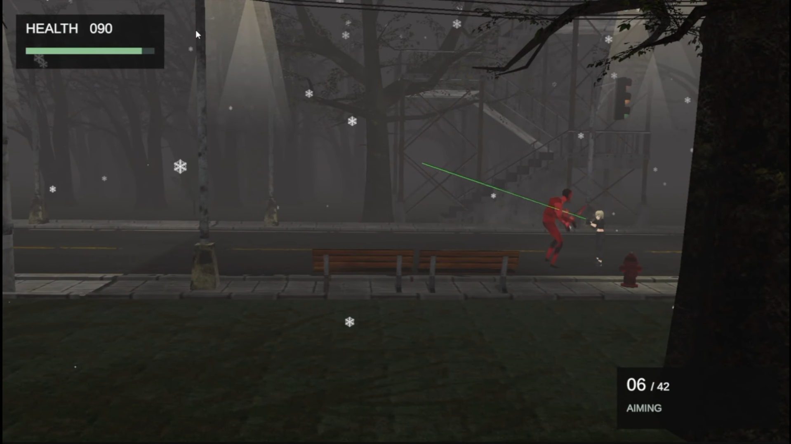
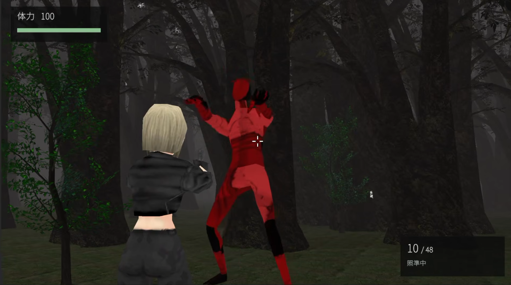

# サバイバルホラーゲーム 制作ポートフォリオ

制作中

## ゲームの紹介

### サバイバルホラーゲーム

氏名　リヤナゲ　シェナル　ナディジャ
ゲームプログラマー志望　個人制作　制作中
制作期間　8か月 現在も制作中
変更前の動画  https://youtu.be/Ea-cbIwZtK4
変更後の動画  https://youtu.be/3X-1d06Ikg0
ソースコード  Google Driveからダウンロード

[ソースコードをダウンロード](https://drive.google.com/file/d/1zbBjax3gF_yrwC0BT0VXfnX9k4P__7d7/view?usp=sharing)

### 作りたいゲーム

『SILENT HILL』のようなホラーゲームが好きで、3Dのサバイバルホラーゲームを作っています。場所によってカメラが変わります。周りに何があるか気にしながら進む、こわいゲームを目指しています。

### 自分で作ったところとAIの利用

一人でゲームを作っています。プレイヤーの操作とゾンビAIのスクリプトは自分で書きました。会話システムは生成AIが作ったコードを使っています。キャラクターなどの素材はSketchfab、アニメーションはMixamoを使いました。

### 使っているツール

Unity 6  6000.0.60f1 ／ C#
Cinemachine 3.1.5 ／ Universal Render Pipeline 17.0.4
AI Navigation 2.0.9

### 今できていること

歩く、走る、後ろに下がる、すばやく後ろを向く操作を作りました。カメラの切替、マウスで狙う操作、射撃、リロードもあります。ほかに、体力、回復、弾を拾う機能、敵の追跡と攻撃、体力と弾の数の表示を作りました。

### 学校での制作と勉強

学校のUnityの授業で、自由にゲームを作る課題として始めました。学期の終わりに先生に作品を見せるため、主に授業の時間に作っています。8か月間、制作しながらC#を勉強しています。バグが出た時や分からないことがあった時は、先生に相談して教えてもらいました。

## Cinemachineを使ったカメラ

### カメラでやりたいこと

通路や曲がり角など、場所によってカメラを変えています。場所に合うカメラの位置や向きを決めて、ホラーゲームの雰囲気を作りたいと考えました。

### 作り方

1　カメラを変えたい場所にTrigger Colliderを置きます。
2　CamSwitcherに使うCinemachineCameraを設定します。
3　Playerが入ると、そのカメラのPriorityを1にします。
4　Playerが出ると、Priorityを0に戻します。

### カメラが変わる仕組み

OnTriggerEnterとOnTriggerExitで、プレイヤーが入ったか、出たかを調べます。新しいカメラを毎回作るのではなく、置いてあるカメラのPriorityを変えます。Priorityはカメラを選ぶための優先度です。MainGameには、この切替を行う場所をいくつか作っています。

### プログラムの一部

if (other.CompareTag("Player"))
    activeCamera.Priority = 1;

プレイヤーが出た時はPriorityを0に戻します。
使っているスクリプト  CamSwitcher.cs

### カメラが変わった時の移動

歩く方向は、キャラクターの前の向きで決まります。プログラムではtransform.forwardを使っています。そのため、カメラが変わっても、前に進むキーを押すとキャラクターの前へ進みます。

### これから確認したいこと

カメラを変える場所が重なると、同じPriorityになることがあります。正しいカメラになるか確認し、必要ならプログラムを直したいです。カメラが変わった時の見やすさも確認します。

## プレイヤーの操作

### 歩く方向と向き

TankControlsでキーの入力を受け取ります。前後のキーで歩き、左右のキーでキャラクターの向きを変えます。この操作はラジコン操作と呼ばれています。移動にはCharacterController.Moveを使っています。

### 歩く速さ

前に進む時に左Shiftを押すと走ります。後ろに下がる時は少し遅くしています。コードの最初の設定では、走る速さは1.5倍、後ろに下がる速さは0.6倍です。Inspectorで数字を変えて、ゲームに合う速さを考えています。

### すばやく後ろを向く操作

Qキーを押すと180度回ります。CoroutineとQuaternion.Slerpを使って、少しずつ回転させています。回っている間は歩けません。終わった後も少し待つ時間を入れて、続けて何度も使えないようにしています。

### 銃を構えた時の操作

Spaceキーで銃を構えます。構えると肩の後ろから見るカメラに変わり、マウスで狙えます。この間は歩けません。Jキーか左クリックで撃ちます。KキーかRキーでリロードします。

### スクリプトの役割

TankControls　キー入力、移動、回転
MovementState　歩く、走る、構えるなどの状態
AnimationDriver　状態に合うアニメーションの設定
ShoulderAim　構えた時のカメラとマウス操作

### アニメーション

Mixamoのアニメーションを使っています。歩く、走る、構えるなどの状態をAnimatorに伝えます。構えた時やすばやく回る時は、ほかの移動アニメーションが同時に出ないように設定しています。

## 友人の意見から変えたこと

### 友人に遊んでもらった時

友人にゲームを遊んでもらうと、「操作が難しい」という意見がありました。そこで、銃で狙いやすくするために、カメラと操作を変えました。

### 変える前と変えた後

前は、場所ごとに変わるカメラのままで、キーを使って左右や上下を狙っていました。
今は、銃を構えると三人称の肩越しカメラに変わります。マウスで狙い、画面の真ん中に照準を表示します。歩いている時は、元のカメラを使います。
変更後の動画  https://youtu.be/3X-1d06Ikg0

### カメラを切り替える方法

ShoulderAimでカメラを動かしています。構える時は、元のカメラとカーソルの設定を保存します。そしてCinemachineBrainを一度止め、自分のスクリプトでカメラを動かします。構えをやめるとBrainの設定を戻し、元のカメラへなめらかに戻します。

### マウスで狙う方法

Mouse Xで左右の向き、Mouse Yで上下の角度を変えます。上下を向きすぎないように、角度に限度をつけました。GetAimPointでは、画面の真ん中からRayを出して、狙っている場所を調べます。プレイヤー自身には当たらないようにしています。

### 壁の近くにいる時

SphereCastでカメラと壁の間を調べます。壁が近い時はカメラをプレイヤーに近づけます。また、カメラの位置や向きを少しずつ変えて、切替が急にならないようにしました。マウスの感度なども設定で変えられます。

### この経験から考えたこと

自分が遊べても、ほかの人には難しいことがあると分かりました。これからも友人に遊んでもらい、変えた操作が使いやすいか確認したいです。その意見を聞いて、さらに直していきたいです。

## 射撃システムの変更前と変更後

### 変更前

遠くから見るカメラで、キーを使って敵を狙っていました。

動画 https://youtu.be/Ea-cbIwZtK4

### 変更後

銃を構えると肩越しのカメラに変わり、マウスで狙えます。

動画 https://youtu.be/3X-1d06Ikg0

## ほかに作った機能とこれから

### 射撃とリロード

Gunクラスで、弾の数や撃つ間隔、リロードの時間を管理しています。撃った時は弾を出し、音やアニメーション、光のエフェクトも出します。リロードする時は、持っている弾の数を調べて必要な分を入れます。

### 敵の動き

ZombieAIでプレイヤーとの距離や角度を調べます。プレイヤーを見つけると、NavMeshAgentで追いかけます。見失った時は、最後に見た場所へ向かいます。近づくと攻撃し、少し待ってから、まだ近くにいるか調べてダメージを与えます。

### 体力と画面の表示

HealthManagerで体力、回復、死亡を管理します。SurvivalHUDでは体力と弾の数、操作の説明を表示します。ポーズや、死亡した後にやり直す機能もあります。死亡した時は歩いたり撃ったりできないようにしています。

### プログラムを書く時に考えたこと

操作、アニメーション、武器、体力、カメラのプログラムを分けています。例えば、弾の数はGunクラスで管理します。移動のプログラムに全部を書くのではなく、役割ごとに分けて書くようにしています。

### これから作りたいこと

メインメニューを作りたいです。
レベルデザインを見直して、ステージをもっとよくしたいです。家のステージも直したいです。
空を飛ぶ敵を新しく作りたいです。
まだ制作中なので、これらを少しずつ進めていきます。

### 使った素材

キャラクターなどの素材　Sketchfab
アニメーション　Mixamo
応募する前に、素材の名前、作者、配布ページと利用ルールをまとめます。
